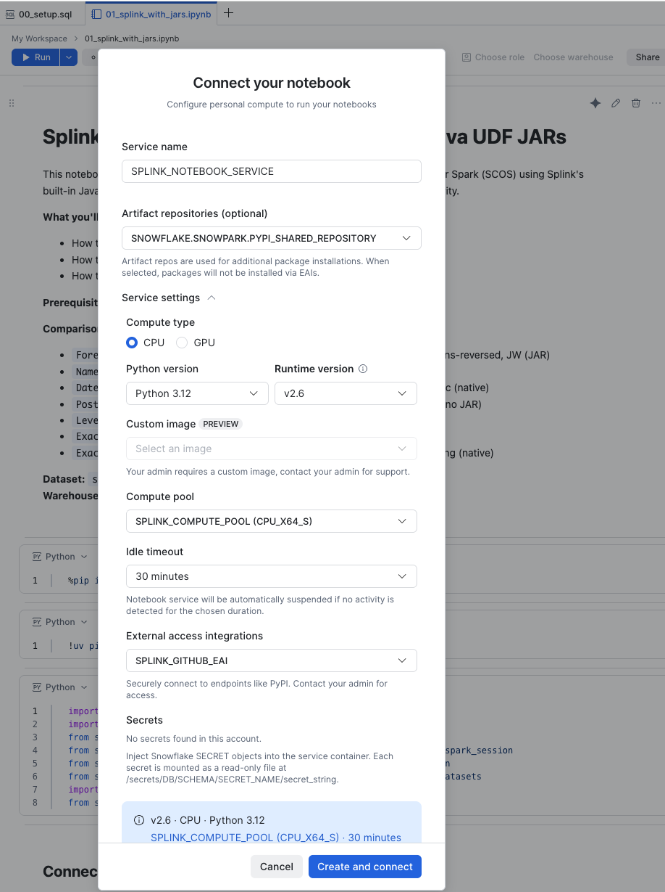

# Splink on Snowflake via Snowpark Connect for Spark

Run [Splink v4](https://github.com/moj-analytical-services/splink) probabilistic record linkage on Snowflake using Snowpark Connect for Spark (SCOS). Two approaches are demonstrated:

> **Read the article:** [TODO: INSERT MEDIUM ARTICLE LINK]

> **License:** [TODO: Add LICENSE file]

1. **Lift-and-shift with Java UDF JARs** — zero Splink code changes; upload the bundled similarity JARs
2. **Zero-JAR with RapidFuzz** — replace JARs with Python scalar UDFs backed by RapidFuzz (C++ engine, Anaconda channel)

## Prerequisites

- A Snowflake account with ACCOUNTADMIN access (for initial setup)
- Python 3.9–3.12
- A Snowpark Connect for Spark (SCOS) environment

## Setup

### 1. Run the setup script

Execute [`00_setup.sql`](00_setup.sql) in Snowsight or SnowSQL. This creates:

- `SPLINK_ROLE` with appropriate grants
- `SPLINK_WH` (MEDIUM warehouse)
- `SPLINK_DEMO.PUBLIC` schema
- `SPLINK_COMPUTE_POOL` (CPU_X64_S, 1 node)
- `SPLINK_GITHUB_EAI` (External Access Integration for GitHub — Splink downloads sample data from `raw.githubusercontent.com`)

### 2. Configure the Compute Pool

After the compute pool is created, you must add the **PyPi artifact repository** to it so that Python packages (splink, rapidfuzz, etc.) can be installed at runtime.

In Snowsight, navigate to the compute pool settings and add the PyPi repository.

### 3. Create a Notebook Service

Create a new Notebook (or SCOS service) using the compute pool, EAI, and Python version shown below:

<!-- TODO: Replace with actual screenshot -->

**Key settings:**
- **Compute Pool:** `SPLINK_COMPUTE_POOL`
- **External Access Integration:** `SPLINK_GITHUB_EAI`
- **Python Version:** 3.12
- **Role:** `SPLINK_ROLE`

### 4. Install dependencies

Each notebook installs its own dependencies from `pyproject.toml` using `uv`. Ensure `pyproject.toml` is in the same directory as the notebooks (or adjust the path in the install cell).

**Note on RapidFuzz:** Notebook 02 uses RapidFuzz for string similarity UDFs. This package is *not* installed locally — it's resolved server-side from Snowflake's Anaconda channel via the `snowpark.connect.udf.packages` configuration. No local install is needed.

## Notebooks

| Notebook | Approach | JARs Required |
|----------|----------|---------------|
| [`01_splink_with_jars.ipynb`](01_splink_with_jars.ipynb) | Native Splink with Java UDF JARs | Yes (2 JARs uploaded via `addArtifact`) |
| [`02_splink_rapidfuzz.ipynb`](02_splink_rapidfuzz.ipynb) | Python UDFs with RapidFuzz | No |

Both notebooks run the full Splink pipeline on the `historical_50k` synthetic dataset (50,000 rows):
1. Load data into a Snowflake-backed Spark DataFrame
2. Configure comparisons and blocking rules
3. Train the model (probability estimation, u-estimation, EM)
4. Predict matches (threshold >= 0.85) and cluster entities (threshold >= 0.95)

## Teardown

When you're done, run [`99_teardown.sql`](99_teardown.sql) to drop all resources created by this project.

## References

- [Splink Documentation](https://moj-analytical-services.github.io/splink/)
- [Snowpark Connect for Spark](https://docs.snowflake.com/en/developer-guide/snowpark-connect/overview)
- [RapidFuzz](https://github.com/maxbachmann/RapidFuzz)
